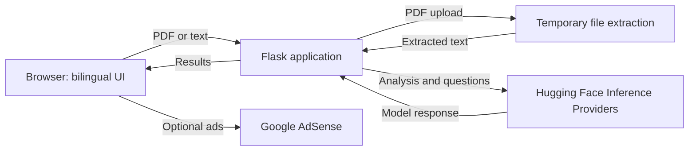

<div align="center">
  

  # LectorIA

  **Read less noise. Understand more.**

  Bilingual AI-assisted analysis for PDFs and plain text.

  [Live site](https://lectoriia.vercel.app/) · [Source code](https://github.com/MichaelAcostaDev/LectorIA)

  
  
  
</div>

## Contents

- [Overview](#overview)
- [Features](#features)
- [Architecture](#architecture)
- [Quickstart](#quickstart)
- [Configuration](#configuration)
- [API and health checks](#api-and-health-checks)
- [Deployment](#deployment)
- [Privacy and security](#privacy-and-security)
- [Testing](#testing)
- [Project structure](#project-structure)
- [Contributing](#contributing)
- [License](#license)

## Overview

LectorIA converts a PDF or pasted text into a grounded summary, key concepts, thematic classification, and answers with page references when available. The interface and analysis support English and Spanish.

AI features use the configured Hugging Face Inference Providers chat-completion model. If the token, model, or provider is unavailable, the application reports an explicit error; it does not present heuristic output as a successful AI result. Scanned PDFs without an extractable text layer are not OCR-processed.

## Features

- Analyze PDFs and pasted text with chunking for longer documents.
- Extract concepts and classify document topics.
- Ask follow-up questions grounded in relevant excerpts and recent conversation turns.
- Preserve PDF page numbers for references where available.
- Switch between English and Spanish, with browser-language detection.
- Serve optional AdSense Auto ads or configured manual slots.
- Process PDF uploads temporarily; the app does not intentionally retain documents or analyses.
- Use a responsive interface with reduced-motion support.

## Architecture



Documents and questions are not stored in a LectorIA user account. Submitted text is sent to the configured AI provider for inference and is subject to that provider's terms and data-handling practices.

## Quickstart

### Requirements

- Python 3.10 or later
- pip
- A Hugging Face token with Inference Providers access for AI analysis

Clone the repository and create an environment:

```text
git clone https://github.com/MichaelAcostaDev/LectorIA.git
cd LectorIA
python -m venv .venv
```

Activate the environment and install dependencies:

**Windows PowerShell**

```powershell
.\.venv\Scripts\Activate.ps1
Copy-Item .env.example .env
python -m pip install -r requirements.txt
```

**macOS / Linux**

```bash
source .venv/bin/activate
cp .env.example .env
python -m pip install -r requirements.txt
```

Edit `.env` and set `HUGGINGFACE_API_TOKEN` if you want to use AI features. Start the server:

```bash
python app.py
```

Open [http://localhost:5000](http://localhost:5000). Without a token, the UI and PDF text extraction remain available, but requests that require AI return a configuration error.

## Configuration

Copy `.env.example` to `.env` for local development. Configure production variables in the hosting provider's secret/environment settings, not in source files.

| Variable | Required | Description |
| --- | --- | --- |
| `HUGGINGFACE_API_TOKEN` | For AI | Fine-grained Hugging Face token with Inference Providers permission. Keep it server-side. |
| `HF_CHAT_MODEL` | No | Chat-completion model ID. Defaults to `Qwen/Qwen2.5-7B-Instruct`. |
| `PORT` | No | Local Flask port; defaults to `5000`. |
| `FLASK_DEBUG` | No | Set to `true` only for local development. |
| `ADSENSE_PUBLISHER_ID` | For ads | Approved publisher ID, in `pub-…` or `ca-pub-…` format. |
| `ADSENSE_AUTO_ADS` | No | Set to `true` to load AdSense Auto ads after approval and publisher configuration. |
| `ADSENSE_SLOT_HERO` | For that slot | Optional manual slot below the hero. |
| `ADSENSE_SLOT_MIDDLE` | For that slot | Optional manual slot between analysis sections. |
| `ADSENSE_SLOT_SIDEBAR` | For that slot | Optional manual slot in the document-details sidebar. |
| `ADSENSE_SLOT_FOOTER` | For that slot | Optional manual slot near the footer. |
| `PRIVACY_CONTACT_EMAIL` | Before public launch | Monitored contact address shown on the privacy page. |

Ad slots can be left blank. In local development, unconfigured locations show layout placeholders; in production they stay hidden. The Hugging Face token is never passed to the browser. The privacy page explicitly indicates when no contact address has been configured.

## API and health checks

- `GET /api/health` reports Flask availability and whether the Hugging Face token is configured. Provider connectivity and model operation are `not_checked`; this endpoint does **not** make an inference request.
- `POST /api/health/ai` performs a minimal real model request. It requires `Authorization: Bearer <HUGGINGFACE_API_TOKEN>` and may incur provider usage. Keep this administrative check private; never call it from the browser or publish the token. Its provider/model status is `not_checked` without a token and `unknown` when connectivity times out.
- `GET /ads.txt` serves the Google seller declaration when a valid publisher ID is configured. Otherwise it returns a non-cacheable `404`.
- `GET /privacy` provides the English or Spanish privacy information.

## Deployment

### Vercel

1. Import the repository into Vercel and retain the included Python build and catch-all route configuration.
2. Set `HUGGINGFACE_API_TOKEN` in the Vercel project's server-side environment variables. Set `HF_CHAT_MODEL` only if you want to override the default. If a deployment already has `HF_CHAT_MODEL` configured and reports that the model is unavailable, update it to `Qwen/Qwen2.5-7B-Instruct` or remove the override, then redeploy.
3. Deploy, then check `/api/health`. To test actual inference, call `/api/health/ai` from a trusted environment with the bearer token; this makes a provider request and is not a public uptime probe.
4. Before serving ads, obtain AdSense approval. Configure `ADSENSE_PUBLISHER_ID`, optionally `ADSENSE_AUTO_ADS=true`, and any manual slot IDs, then redeploy.
5. Configure Google AdSense privacy and consent messaging. Google requires an approved Google-certified consent management platform for applicable users in the EEA, UK, and Switzerland. This application does not implement a CMP.
6. Set `PRIVACY_CONTACT_EMAIL` to a monitored address before making the service available publicly.

The PDF file-size limit is 4 MiB on Vercel and 15 MiB in local deployments. The HTTP request limit on Vercel is 4,500,000 bytes to leave room for multipart upload overhead; requests larger than that return `413`. AI analysis is limited to 180,000 characters and 32 generated excerpts.

Configuring environment variables does not itself verify provider inference, AdSense approval, or a successful production deployment. Confirm each item in the target account and deployment.

## Privacy and security

- Keep all tokens in environment variables. `.env` is ignored by Git; `.env.example` contains placeholders only.
- If a token was exposed, revoke it and create a replacement. Do not copy the exposed token into deployment settings or commit history.
- Uploaded PDFs are size-checked and temporarily written for text extraction, then deleted. Extracted text is sent to the configured Hugging Face provider for requested AI analysis.
- Review current Hugging Face inference-provider data-handling terms before sending documents. Avoid sensitive or confidential content.
- If AdSense is enabled, Google and its partners may use cookies or similar technologies. Configure a certified consent platform where required.
- Use the [privacy page](/privacy) for the service's current processing disclosures. Configure `PRIVACY_CONTACT_EMAIL` before public launch.
- Do not put credentials, real documents, or private user data in issues, logs, screenshots, or pull requests. Report security issues privately to the repository owner.

## Testing

Run the unit tests:

```bash
python -m unittest discover -s tests -v
```

The suite covers document chunking and analysis behavior, API validation, PDF upload errors, health-check authorization, AdSense configuration, and privacy-page rendering. Unit tests mock the external AI provider; they do not prove that a live provider request or deployment works.

## Project structure

```text
LectorIA/
├── ai_utils.py          # Hugging Face requests, prompts, chunking, and analysis
├── app.py               # Flask UI, API routes, health checks, and ads.txt
├── pdf_utils.py         # PDF validation and temporary text extraction
├── requirements.txt
├── vercel.json
├── .env.example
├── LICENSE
├── tests/
│   ├── test_ai_utils.py
│   └── test_app.py
├── static/
│   ├── favicon.svg
│   ├── logo-mark.svg
│   ├── script.js
│   └── style.css
└── templates/
    ├── index.html
    └── privacy.html
```

## Contributing

1. Fork the repository and create a focused branch.
2. Make changes and add or update tests.
3. Run the test suite above.
4. Open a pull request describing behavior and deployment implications.

Avoid including real documents, API tokens, publisher IDs, or other sensitive data in contributions.

## License

LectorIA's code is released under the [MIT License](./LICENSE). Model weights, Hugging Face services, and third-party assets remain subject to their own terms and licenses.
