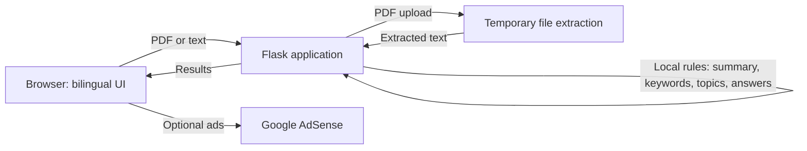

<div align="center">
  

  # LectorIA

  **Read less noise. Understand more.**

  Bilingual local analysis for PDFs and plain text, with no AI model.

  [Live site](https://lectoriia.vercel.app/) · [Source code](https://github.com/MichaelAcostaDev/LectorIA)

  
  
  
</div>

## Overview

LectorIA converts a PDF or pasted text into an extractive summary, frequent key terms, rule-based thematic labels, and answers selected from matching sentences with page references when available. The interface supports English and Spanish.

Analysis runs in the Flask application using deterministic text-processing rules. It does not load or call an AI model and does not send document text to an inference provider. Results are extractive and heuristic; they are not generated or interpreted by AI. Scanned PDFs without an extractable text layer are not OCR-processed.

## Features

- Analyze PDFs and pasted text locally with chunking for longer documents.
- Extract frequent terms and classify topics with bilingual keyword rules.
- Answer questions by retrieving sentences that share words with the question.
- Preserve PDF page numbers for references where available.
- Switch between English and Spanish, with browser-language detection.
- Serve optional AdSense Auto ads or configured manual slots.
- Process PDF uploads temporarily; the app does not intentionally retain documents or analyses.
- Use a responsive interface with reduced-motion support.

## Architecture



Documents are processed by the application server and are not sent to an AI model. The hosting provider may process requests and technical logs according to its own terms.

## Quickstart

### Requirements

- Python 3.10 or later
- pip

Clone the repository and create an environment:

```text
git clone https://github.com/MichaelAcostaDev/LectorIA.git
cd LectorIA
python -m venv .venv
```

Activate the environment and install dependencies:

**Windows PowerShell**

```powershell
.\.venv\Scripts\Activate.ps1
python -m pip install -r requirements.txt
```

**macOS / Linux**

```bash
source .venv/bin/activate
python -m pip install -r requirements.txt
```

Start the server:

```bash
python app.py
```

Open [http://localhost:5000](http://localhost:5000). Analysis uses local text-processing rules and does not require an AI account, API key, or model.

## Configuration

No AI-provider configuration is needed. Optional server settings can be provided through environment variables or a local `.env` file:

| Variable | Required | Description |
| --- | --- | --- |
| `PORT` | No | Local Flask port; defaults to `5000`. |
| `FLASK_DEBUG` | No | Set to `true` only for local development. |
| `ADSENSE_PUBLISHER_ID` | For ads | Approved publisher ID, in `pub-…` or `ca-pub-…` format. |
| `ADSENSE_AUTO_ADS` | No | Set to `true` to load AdSense Auto ads after approval and publisher configuration. |
| `ADSENSE_SLOT_HERO` | For that slot | Optional manual slot below the hero. |
| `ADSENSE_SLOT_MIDDLE` | For that slot | Optional manual slot between analysis sections. |
| `ADSENSE_SLOT_SIDEBAR` | For that slot | Optional manual slot in the document-details sidebar. |
| `ADSENSE_SLOT_FOOTER` | For that slot | Optional manual slot near the footer. |
| `PRIVACY_CONTACT_EMAIL` | Before public launch | Monitored contact address shown on the privacy page. |

Ad slots can be left blank. In local development, unconfigured locations show layout placeholders; in production they stay hidden. The privacy page indicates when no contact address has been configured.

## API and health checks

- `GET /api/health` reports Flask availability and confirms analysis mode is local with no external model.
- `POST /api/health/ai` is retained for compatibility and reports local analysis availability; it makes no external request and requires no authorization.
- `GET /ads.txt` serves the Google seller declaration when a valid publisher ID is configured. Otherwise it returns a non-cacheable `404`.
- `GET /privacy` provides the English or Spanish privacy information.

## Deployment

### Vercel

1. Import the repository into Vercel and retain the included Python build and catch-all route configuration.
2. No AI provider credentials or model settings are required.
3. Deploy and check `/api/health`; the response reports local analysis mode.
4. Before serving ads, obtain AdSense approval. Configure `ADSENSE_PUBLISHER_ID`, optionally `ADSENSE_AUTO_ADS=true`, and any manual slot IDs, then redeploy.
5. Configure Google AdSense privacy and consent messaging. Google requires an approved Google-certified consent management platform for applicable users in the EEA, UK, and Switzerland. This application does not implement a CMP.
6. Set `PRIVACY_CONTACT_EMAIL` to a monitored address before making the service available publicly.

The PDF file-size limit is 4 MiB on Vercel and 15 MiB in local deployments. The HTTP request limit on Vercel is 4,500,000 bytes to leave room for multipart upload overhead; requests larger than that return `413`. Text analysis is limited to 180,000 characters and 32 excerpts. Local analysis has no AI-provider usage fees, but it is not unlimited: hosting quotas, request limits, and processing time still apply.

## Privacy and security

- Analysis does not use or require AI-provider tokens.
- Uploaded PDFs are size-checked and temporarily written for text extraction, then deleted. Extracted text is processed by the application server and is not sent to an AI model or inference provider.
- If AdSense is enabled, Google and its partners may use cookies or similar technologies. Configure a certified consent platform where required.
- Use the [privacy page](/privacy) for the service's current processing disclosures. Configure `PRIVACY_CONTACT_EMAIL` before public launch.
- Do not put credentials, real documents, or private user data in issues, logs, screenshots, or pull requests. Report security issues privately to the repository owner.

## Testing

Run the unit tests:

```bash
python -m unittest discover -s tests -v
```

The suite covers document chunking, local extractive analysis, question retrieval, API validation, PDF upload errors, AdSense configuration, and privacy-page rendering. No external AI provider is used.

## Project structure

```text
LectorIA/
├── ai_utils.py          # Local text processing, chunking, and analysis
├── app.py               # Flask UI, API routes, health checks, and ads.txt
├── pdf_utils.py         # PDF validation and temporary text extraction
├── requirements.txt
├── vercel.json
├── .env.example
├── LICENSE
├── tests/
│   ├── test_ai_utils.py
│   └── test_app.py
├── static/
│   ├── favicon.svg
│   ├── logo-mark.svg
│   ├── script.js
│   └── style.css
└── templates/
    ├── index.html
    └── privacy.html
```

## Contributing

1. Fork the repository and create a focused branch.
2. Make changes and add or update tests.
3. Run the test suite above.
4. Open a pull request describing behavior and deployment implications.

Avoid including real documents, API tokens, publisher IDs, or other sensitive data in contributions.

## License

LectorIA's code is released under the [MIT License](./LICENSE). Hosting and third-party assets remain subject to their own terms and licenses.
