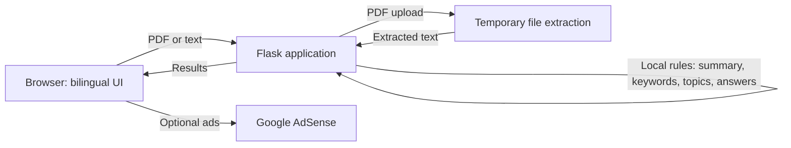

  

  # LectorIA

  **Read less noise. Understand more.**

  Bilingual local analysis for PDFs and plain text, with no AI model.

  [Live site](https://lectoriia.vercel.app/) · [Source code](https://github.com/MichaelAcostaDev/LectorIA)

  
  
  

## Overview

LectorIA converts a PDF or pasted text into an extractive summary, frequent key terms, rule-based thematic labels, and answers selected from matching sentences with page references when available. The interface supports English and Spanish.

Analysis runs in the Flask application using deterministic text-processing rules. It does not load or call an AI model and does not send document text to an inference provider. Results are extractive and heuristic; they are not generated or interpreted by AI. Scanned PDFs without an extractable text layer are not OCR-processed.

## Features

- Analyze PDFs and pasted text locally with chunking for longer documents.
- Extract frequent terms and classify topics with bilingual keyword rules.
- Answer questions by retrieving sentences that share words with the question.
- Preserve PDF page numbers for references where available.
- Switch between English and Spanish, with browser-language detection.
- Serve optional AdSense Auto ads or configured manual slots.
- Process PDF uploads temporarily; the app does not intentionally retain documents or analyses.
- Use a responsive interface with reduced-motion support.

## Architecture

Documents are processed by the application server and are not sent to an AI model. The hosting provider may process requests and technical logs according to its own terms.

## Privacy and security

- Analysis does not use or require AI-provider tokens.
- Uploaded PDFs are size-checked and temporarily written for text extraction, then deleted. Extracted text is processed by the application server and is not sent to an AI model or inference provider.
- If AdSense is enabled, Google and its partners may use cookies or similar technologies. Configure a certified consent platform where required.
- Use the [privacy page](/privacy) for the service's current processing disclosures. Configure `PRIVACY_CONTACT_EMAIL` before public launch.
- Do not put credentials, real documents, or private user data in issues, logs, screenshots, or pull requests. Report security issues privately to the repository owner.

## Contributing

1. Fork the repository and create a focused branch.
2. Make changes and add or update tests.
3. Run the test suite above.
4. Open a pull request describing behavior and deployment implications.

Avoid including real documents, API tokens, publisher IDs, or other sensitive data in contributions.

## License

LectorIA's code is released under the [MIT License](./LICENSE). Hosting and third-party assets remain subject to their own terms and licenses.